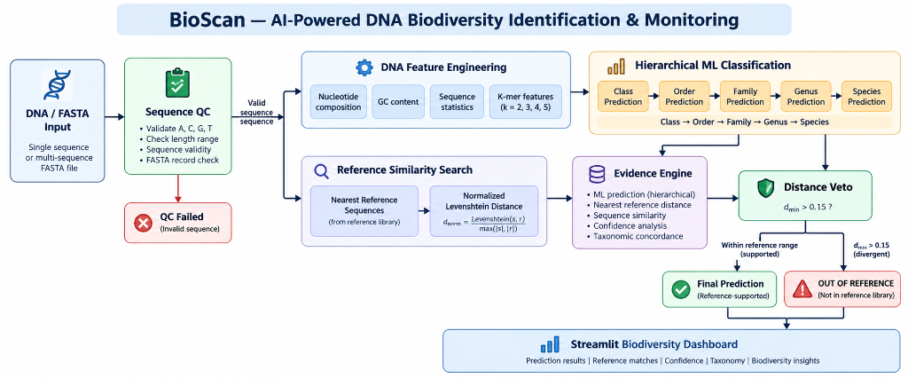

# 🧬 BioScan
### AI-Powered DNA Biodiversity Identification & Monitoring System

BioScan is an AI-powered eDNA analysis system that combines hierarchical machine learning, DNA similarity search, and unknown-sequence detection for biodiversity identification and monitoring.

---

## Quick Start

```bash
git clone https://github.com/Vedika-k187/BioScan && cd BioScan
python3 -m venv .venv && source .venv/bin/activate
pip install -r requirements.txt
brew install libomp            # macOS only: required by XGBoost
pytest -q                      # 119 tests
streamlit run app/app.py       # dashboard at http://localhost:8501
```

Python API:

```python
from src.prediction.predictor import predict_sequence
result = predict_sequence("ACTATGCTCAGTCATAAACTTTGG...")
print(result["status"], result["predicted_taxonomy"])
```

## Validation: does the Distance Veto detect unknowns?

Run: `PYTHONPATH=. python src/evaluation/run_unknown_detection.py`

| Test set | n | Median distance | Flagged not-known | Out-of-reference |
|---|---|---|---|---|
| Known references + 2% noise (should stay known) | 60 | 0.019 | 10.0% | 0.0% |
| Held-out genus (whole genus removed from library) | 97 | 0.073 | 89.7% | 11.3% |
| Real non-fish 12S from NCBI (mouse, cow, frog, ...) | 39 | 0.495 | 100% | 100% |

Figure: `reports/figures/unknown_detection_distance.png`. The close-match threshold
(0.03) was chosen from this experiment: 0.05 let 30% of unseen genera through as "known".
Species labels are never asserted unless a reference is within 0.03 (see
`tests/test_regression_species.py`).

## Limitations (read before trusting a result)

- **Tiny reference library:** 101 unique 12S sequences, 89 of 90 species are singletons. Species
  output is reference matching, not generalisation; the species ML model has ~0% leave-one-out
  accuracy and is not used to assert species.
- **Unseen relatives:** about 10% of sequences from a genus absent from the library still fall
  within the close threshold of a related reference (12S is conserved); they are assigned that
  reference's lineage.
- **Scope:** one marker (12S V5), marine fish, one survey (2019 NJ Ocean Trawl). `out_of_reference`
  means "not in this library", not "new species".
- **Negative controls** are windows of full-length NCBI 12S records, not amplicon reads.

## 1. Problem

Environmental DNA (eDNA) enables biodiversity detection from genetic material collected from environmental samples.

However, conventional DNA classifiers have a major limitation:

- They are **closed-set** and are forced to predict one of the species they were trained on.
- An unfamiliar DNA sequence can therefore receive a **high-confidence but incorrect species prediction**.
- Limited reference sequences make species-level identification difficult.
- A species prediction alone does not show how strongly the DNA is supported by the reference library.

**The key challenge:**  
How can we identify DNA while also determining whether the sequence is actually supported by the available reference data?

---

## 2. Solution

BioScan combines **machine learning + sequence-level evidence**.

Instead of relying only on classifier probability, BioScan:

1. Validates the DNA sequence.
2. Extracts DNA and k-mer features.
3. Predicts taxonomy hierarchically from **Class → Order → Family → Genus → Species**.
4. Searches for the closest reference DNA sequences.
5. Calculates sequence similarity using normalized Levenshtein distance.
6. Applies a **Distance Veto** to detect sequences outside the reference library.
7. Provides the final prediction together with supporting evidence.

This makes BioScan a **reference-aware DNA identification system rather than a simple closed-set classifier**.

---
## 3. System Architecture



**Core Flow:**  
DNA / FASTA Input → Sequence QC → Feature Engineering → Hierarchical ML + Similarity Search → Evidence Engine → Distance Veto → Final Prediction / Out of Reference → Biodiversity Dashboard
