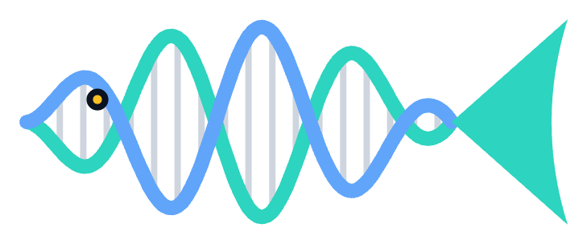
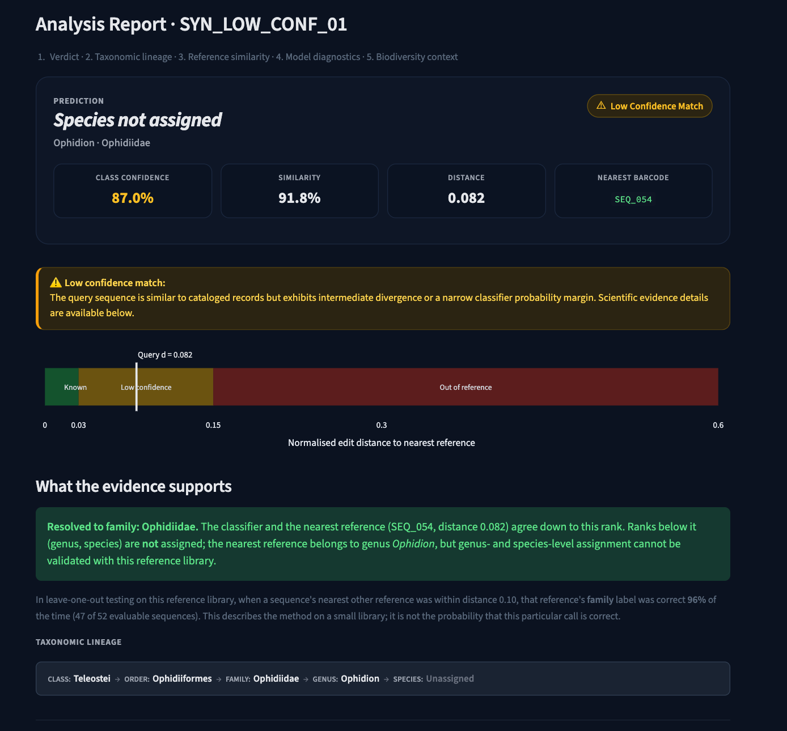
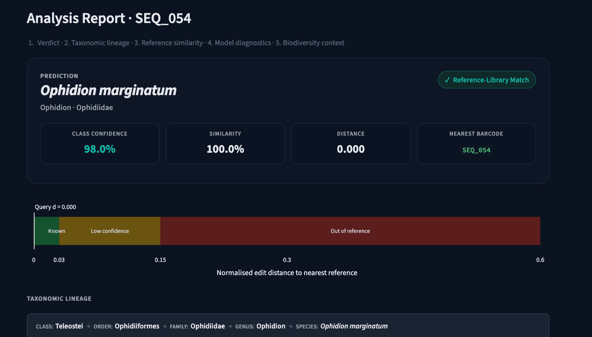
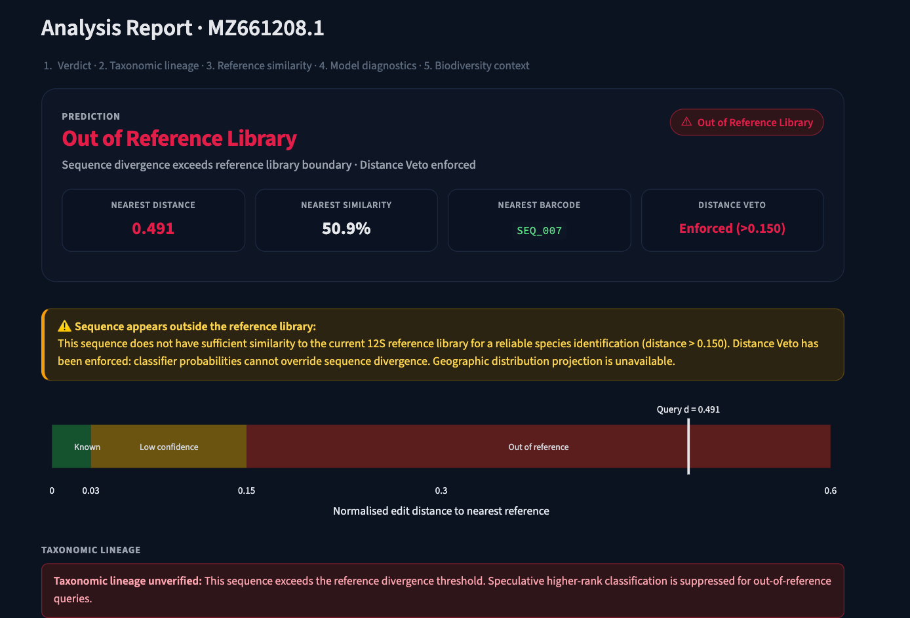
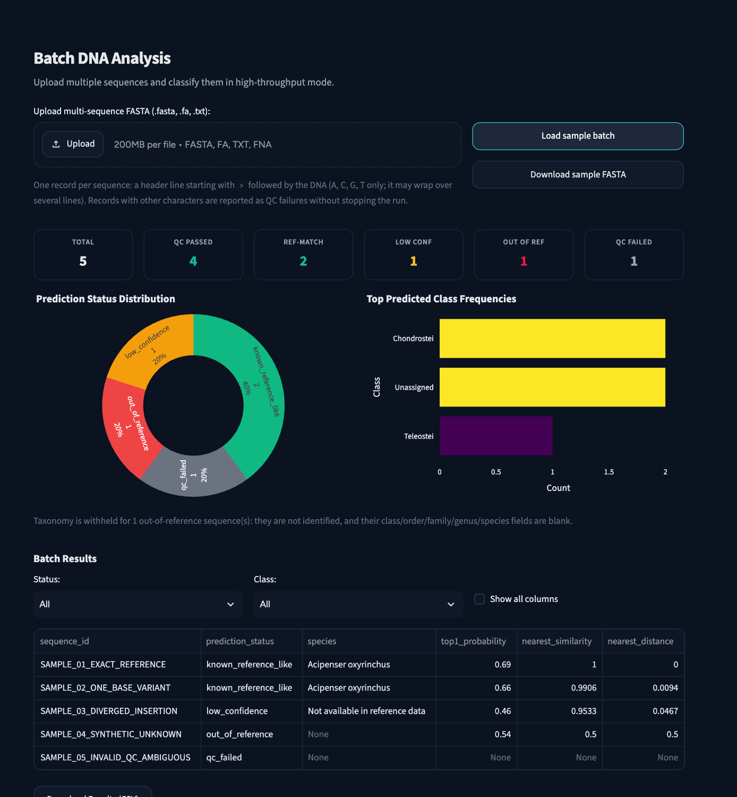
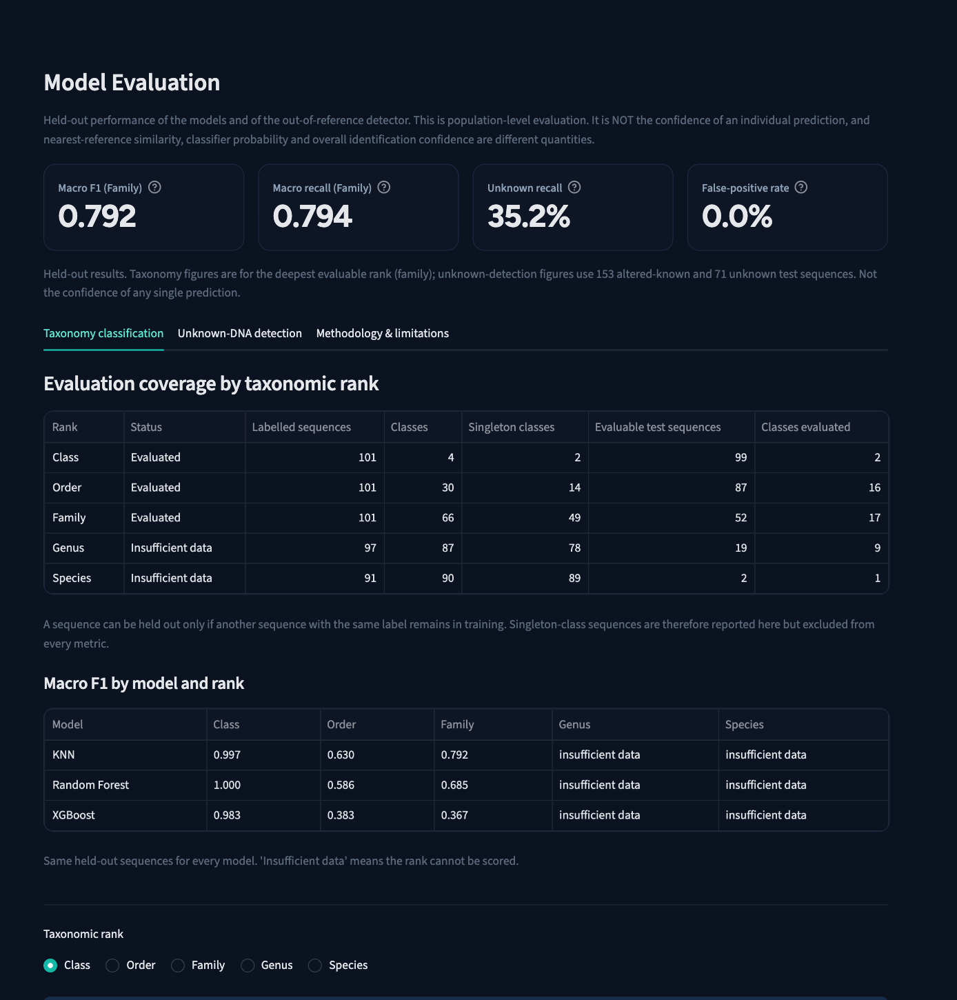
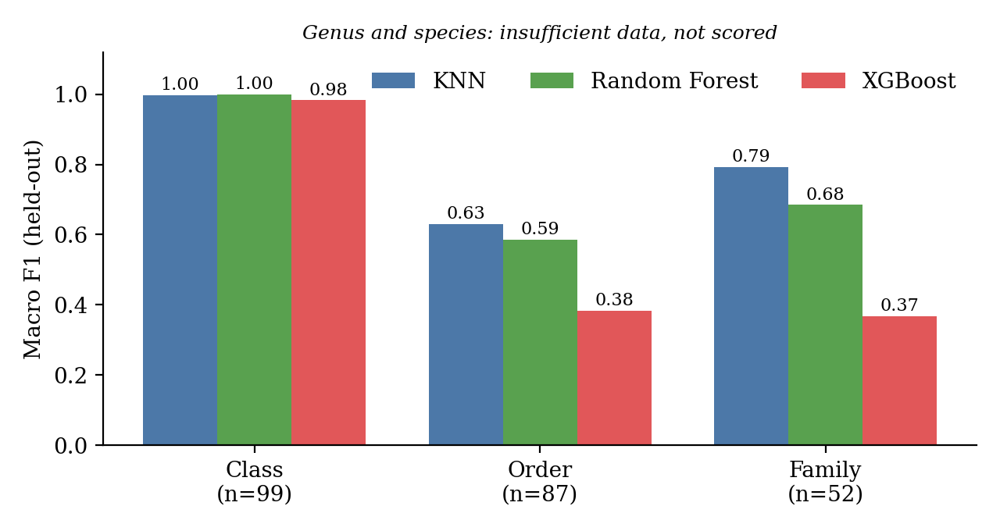
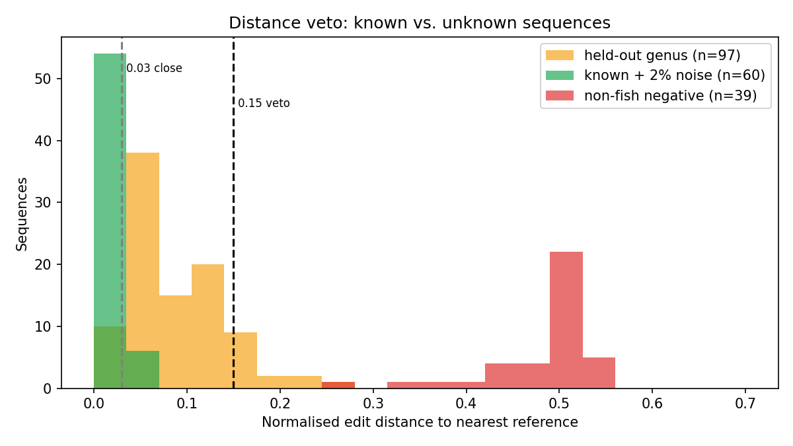

<p align="center">
  
</p>

<h1 align="center">BioScan</h1>
<p align="center"><b>Reference-aware DNA barcode identification for fish eDNA</b><br>
It names a fish only as deep as the evidence supports, and refuses sequences it has never seen.</p>

<p align="center">
  <a href="https://bioscan-dna.streamlit.app">Live app</a> ·
  <a href="docs/BioScan_Mini_Project_Report.pdf">Project report</a> ·
  <a href="reports/EVALUATION_METHODOLOGY.md">Evaluation method</a>
</p>

<p align="center">
  
  
  
  
</p>



---

## Why BioScan

Environmental DNA (eDNA) lets scientists detect fish from a water sample. The hard step is
naming each DNA sequence. Two things usually go wrong:

- A normal classifier must pick one of the species it was trained on, so a sequence from an
  unknown animal can still get a confident species name.
- A similarity search returns a best hit even when the true species is not in the library.

BioScan adds the missing question: **is this sequence actually supported by the reference
library?** If not, it says so instead of guessing.

## What it does

| You give it | It tells you |
|---|---|
| A 12S fish barcode (one sequence or a FASTA file) | Whether it is a **known reference**, **low confidence**, or **out of reference** |
| | The taxonomy **only as deep as the evidence supports** (class, order, family, genus, species) |
| | The closest reference sequences, with distance and similarity |
| | Where the matching reference was detected in the 2019 New Jersey survey |
| | How accurate this method has been on held-out data |

| Status | Distance to nearest reference | What BioScan does |
|---|---|---|
| Known reference | ≤ 0.03 | Names the taxon down to species |
| Low confidence | 0.03 to 0.15 | Names only the ranks both the classifier and the nearest reference agree on (up to family) |
| Out of reference | > 0.15 | The **Distance Veto**: no taxonomy and no map, whatever the classifier says |

## Try it

**Live app:** https://bioscan-dna.streamlit.app (the free tier sleeps after inactivity, so the
first load can take about a minute).

Examples built into the Identify page ("Try an example"):

| Example | Expected result |
|---|---|
| Exact reference | Known reference, species named |
| 1-base variant | Known reference, species named |
| Low-confidence query | Resolved to family only |
| Real non-fish sequence | Out of reference, taxonomy withheld |
| Invalid (contains N) | Rejected by quality control |

## Screenshots

| Known reference | Out of reference |
|---|---|
|  |  |

| Batch analysis | Model evaluation |
|---|---|
|  |  |

## How it works


1. **Quality control.** Only A, C, G and T are accepted. Ambiguous bases and non-DNA are rejected, not guessed.
2. **Features.** Base composition, complexity, and k-mer (k = 2, 3) frequencies.
3. **Hierarchical classifiers.** Class, order, family, genus and species are predicted in turn, each restricted to the children of the rank above.
4. **Similarity search.** Normalised Levenshtein (edit) distance to all 101 reference barcodes.
5. **Evidence engine.** Combines classifier probability, margin and entropy with the nearest distance and the agreement between the two.
6. **Distance Veto.** If the nearest distance is above 0.15 the sequence is out of reference, whatever the classifier says.
7. **Dashboard.** Verdict, distance gauge, what the evidence supports, survey map, and measured accuracy.

## Data

| | |
|---|---|
| Source | 2019 New Jersey Ocean Trawl eDNA survey, NCBI BioProject [PRJNA638560](https://www.ncbi.nlm.nih.gov/bioproject/PRJNA638560) |
| Marker | Mitochondrial 12S rRNA, V5 region (MiFish-style primers), 87 to 112 bp |
| Raw table | 13,736 rows × 59 columns, SHA-256 recorded and never modified |
| Unique sequences | **101** (each is repeated 136 times across 68 sampling events × 2 primers) |
| Taxonomy | 4 classes, 30 orders, 66 families, 87 genera, 90 named species |
| Survey metadata | 36 stations, 1,604 de-duplicated occurrence records |

All modelling and evaluation use the 101 unique sequences, never the duplicated rows.

## Results

Held-out, leave-one-sequence-out, on unique sequences (no leakage). Full method in
[`reports/EVALUATION_METHODOLOGY.md`](reports/EVALUATION_METHODOLOGY.md).

### Taxonomy

| Rank | Test n | Classes tested | Model in app | Macro F1 | Balanced acc. | Top-1 acc. |
|---|---|---|---|---|---|---|
| Class | 99 | 2 of 4 | Random Forest | 1.000 | 1.000 | 1.000 |
| Order | 87 | 16 of 30 | Random Forest | 0.586 | 0.601 | 0.759 |
| Family | 52 | 17 of 66 | KNN | 0.792 | 0.794 | 0.865 |
| Genus | 19 | n/a | not scored | insufficient data | | |
| Species | 2 | n/a | not scored | insufficient data | | |



### Unknown-DNA detection (positive = out of reference)

153 altered known sequences and 71 unknown sequences on the held-out test half.

| Rule | Precision | Recall | False-positive rate | Coverage |
|---|---|---|---|---|
| Production Distance Veto | 1.000 | 0.352 | 0.000 | 0.482 |
| Reject or abstain (low confidence counts) | 0.560 | 0.915 | 0.333 | 0.482 |

| Test category | n | Flagged out of reference |
|---|---|---|
| Altered known (1, 2 and 5 substitutions) | 153 | 0% |
| Held-out genus | 52 | 11.5% |
| External non-fish sequences | 19 | 100% |



## Limitations (read before trusting a result)

- **Tiny reference library.** 101 unique sequences, and 89 of 90 species have exactly one.
  Genus and species generalisation cannot be evaluated, and species output is reference
  matching, not a validated classifier.
- **Class-level scores** come from only two testable classes, so they describe an almost binary task.
- **A plain nearest-reference search is as accurate as the trained models above class level**
  (order 81.6%, family 90.4% leave-one-out), so the value is in the evidence logic and the veto.
- **Thresholds were tuned on these same sequences.** The 0.03 and 0.15 values are therefore
  optimistic; a threshold chosen on a separate half is reported alongside.
- **"Out of reference" means "not in this library".** It does not prove a new species.
- **Not evaluated:** insertions and deletions, real sequencing reads, a BLAST comparison,
  and external datasets.

## Run it locally

```bash
git clone https://github.com/Vedika-k187/BioScan && cd BioScan
python3 -m venv .venv && source .venv/bin/activate
pip install -r requirements.txt
brew install libomp            # macOS only, required by XGBoost
streamlit run app/app.py       # http://localhost:8501
```

Use it from Python:

```python
from src.prediction.predictor import predict_sequence

result = predict_sequence("ACTATGCTAAGCCTTAAACACAGACAAATGCTCTGTCCGCCAGGGTATTACGAGC...")
print(result["status"], result["predicted_taxonomy"])
```

### Batch input (FASTA)

```
>sample_01
ACTATGCTAAGCCTTAAACACAGACAAATGCTCTGTCCGCCAGGGTATTACGAGC...
>sample_02
ACTATGCTCAGTCATAAACTTTGGTGATAAATTACACATATTGCCCGCCAGGGTAC...
```

One record per sequence, A/C/G/T only. Records with other characters are reported as QC
failures without stopping the run. The Batch page has a sample file to download.

### Tests and reproducing the results

```bash
pytest -q                                                     # 172 tests
PYTHONPATH=. python src/evaluation/run_model_evaluation.py    # regenerates evaluation_results.json
PYTHONPATH=. python src/evaluation/run_unknown_detection.py   # distance histogram and summary
```

## Project structure

```
app/              Streamlit dashboard (pages, components, styling)
src/
  preprocessing/  cleaning and reference library construction
  features/       composition and k-mer features
  models/         KNN, Random Forest, XGBoost, hierarchical taxonomy
  similarity/     Levenshtein reference search
  prediction/     QC, evidence engine, Distance Veto, batch and FASTA
  biodiversity/   survey analytics (diversity, occurrence, geography)
  evaluation/     leakage-safe metrics, splits, evaluation runner
models/           trained model artefacts (joblib)
data/             raw, processed and external (non-fish control) data
reports/          phase reports, model and dataset cards, evaluation results
tests/            172 automated tests
docs/             architecture diagram, screenshots, project report
```

## Documentation

- [Project report (PDF)](docs/BioScan_Mini_Project_Report.pdf)
- [Evaluation methodology and extension plan](reports/EVALUATION_METHODOLOGY.md)
- [Model card](reports/MODEL_CARD.md) and [dataset card](reports/DATASET_CARD.md)

## Roadmap

- A larger, independently sourced reference library with several sequences per species
- A benchmark against BLAST or vsearch on the same held-out queries
- FASTQ-to-ASV preprocessing for real eDNA reads
- Better threshold calibration on larger data, plus ambiguous-base and reverse-complement tolerance
- Containerised deployment with continuous integration

## Authors

Vedika Kurhade and Shreya Jadhav, Cummins College of Engineering for Women, Pune.

## License

MIT. See [LICENSE](LICENSE).
